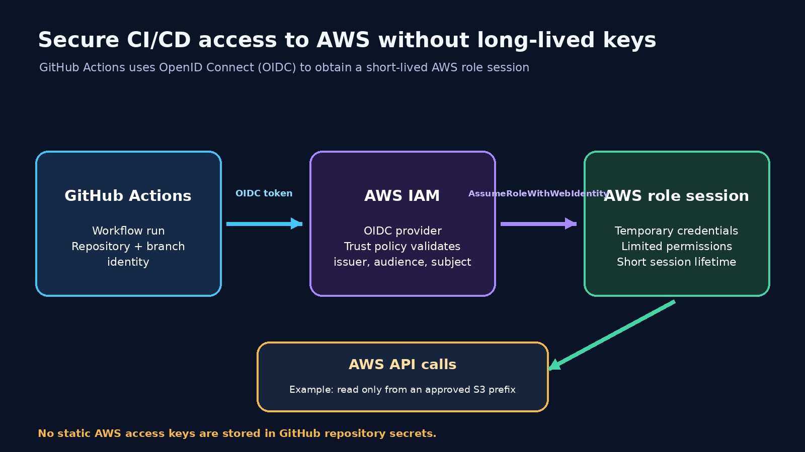
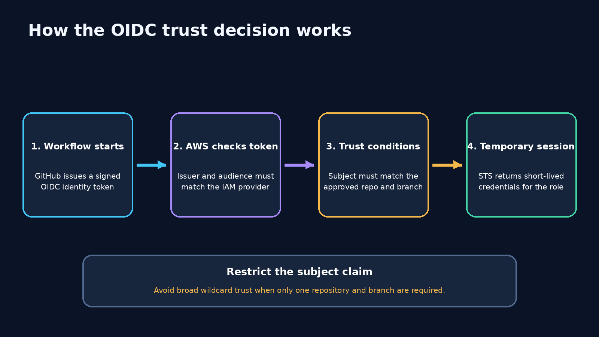

# Secure AWS Automation with GitHub Actions and OpenID Connect (OIDC)

**Level:** Intermediate  
**Focus:** AWS IAM, temporary credentials, OpenID Connect, GitHub Actions, least privilege.

> **Implementation status:** This is a reference implementation. It has not been deployed or validated in a live AWS account. Validate the provider, trust policy, permissions, and workflow in a dedicated test environment before relying on it.

## Introduction

CI/CD pipelines often need access to cloud resources: publishing an artifact, deploying an application, or updating infrastructure. A common shortcut is to create an IAM user's access key and store it as a CI/CD secret. These credentials are reusable until rotated or revoked. If exposed through a compromised runner, workflow, or accidental logging, they may be used outside the pipeline.

AWS supports a different pattern: a workload proves its identity using OpenID Connect (OIDC), then requests temporary AWS credentials for an IAM role. This article explains that pattern using GitHub Actions and AWS Security Token Service (AWS STS).

The objective is not just to remove access keys. It is to establish a narrowly scoped trust relationship between one repository/branch and one AWS role, then grant that role only the permissions the workflow needs.



*Figure 1. GitHub Actions obtains a short-lived role session through OIDC instead of using a stored long-lived AWS access key.*

## 1. Why long-lived access keys are risky

Static IAM user access keys can remain valid for a long time. They may be copied into workflows, developer machines, or secret stores. Rotation becomes an operational task, and every copy must be updated safely.

Common risks include accidental commits, credentials printed by workflows, compromised runners, keys remaining active after a project ends, and broad permissions increasing the impact of exposure.

Secret storage is important for credentials that must exist, but it does not change the fact that a static access key is reusable. Where workload federation is supported, short-lived credentials are usually a better fit.

## 2. The building blocks

| Component | Responsibility |
|---|---|
| GitHub Actions | Runs the automation workflow. |
| GitHub OIDC issuer | Issues a signed identity token for the workflow context. |
| AWS IAM OIDC provider | Establishes trust in the token issuer and audience. |
| IAM role trust policy | Defines which federated identities may assume the role. |
| AWS STS | Validates the token and issues temporary credentials. |
| IAM permissions policy | Defines what the assumed role can do in AWS. |

Two policy types must be understood separately:

- **Trust policy:** Who can assume this role?
- **Permissions policy:** What can the role do after it is assumed?

A restrictive trust policy does not compensate for an overly broad permissions policy, and vice versa.

## 3. How the OIDC flow works



*Figure 2. AWS validates the token issuer and audience, evaluates the role trust conditions, and STS issues a temporary session.*

1. A GitHub Actions job starts.
2. The workflow is allowed to request an OIDC token by declaring `id-token: write`.
3. GitHub issues a signed token describing the workflow identity.
4. The AWS credentials action presents the token to AWS STS using `AssumeRoleWithWebIdentity`.
5. AWS validates the token against the configured GitHub OIDC provider and evaluates the IAM role trust policy.
6. If authorized, STS returns temporary credentials.
7. The workflow uses those credentials to call permitted AWS APIs. The session expires according to the role session duration.

`id-token: write` permits the job to request an OIDC token; it does not itself grant AWS permissions. AWS authorization still depends on the role trust policy and attached permissions.

## 4. Configure the GitHub OIDC provider in AWS

An IAM OIDC identity provider must exist in the AWS account before a role can trust it.

- Provider URL: `https://token.actions.githubusercontent.com`
- Client ID (audience): `sts.amazonaws.com`

Create the provider in IAM using the AWS Console or your approved infrastructure-as-code process. Confirm current AWS and GitHub documentation for provider setup and certificate/thumbprint handling rather than copying an old thumbprint from an example.

The Terraform example in this project accepts the ARN of an already-created GitHub OIDC provider as an input. This keeps provider lifecycle management separate from the example role. Do not create duplicate providers for the same issuer in one account; reuse an existing provider where appropriate.

## 5. Restrict the role trust policy

For a workflow running from the `main` branch of one repository, the expected subject claim has this form:

`repo:OWNER/REPOSITORY:ref:refs/heads/main`

The Terraform example builds the subject from input variables and requires an exact match. It also checks that the audience is `sts.amazonaws.com`.

The trust policy should allow the configured GitHub OIDC provider as the federated principal, the `sts:AssumeRoleWithWebIdentity` action, the expected audience, and the exact repository-and-branch subject.

Avoid broad conditions such as `repo:OWNER/*` unless every repository in that scope is intentionally trusted. A wildcard can allow an unintended repository to assume the role.

### Branches and GitHub Environments

The subject format changes when a workflow uses a GitHub Environment. The subject can identify the environment instead of the branch. If you add an environment such as `production`, update the trust policy to match the exact subject format and configure environment protection rules. Do not copy a branch-based trust policy unchanged into an environment-based workflow.

## 6. Grant only the permissions the workflow needs

The example role has a deliberately small read-only S3 policy for one bucket and the `reports/` prefix:

- `s3:ListBucket` on the specific bucket, constrained by the `s3:prefix` condition.
- `s3:GetObject` on objects under `reports/` in that bucket.

It does not grant bucket creation, object writes, deletion, IAM administration, or access to every S3 bucket.

For a real pipeline, start with the exact API operations required. Scope resource ARNs wherever the service supports resource-level permissions. Some actions require `"Resource": "*"`; document why and consider applicable condition keys. Do not attach `AdministratorAccess` just to make a workflow succeed.

## 7. Configure the GitHub Actions workflow

The sample workflow is in `.github/workflows/oidc-demo.yml`. It runs on pushes to `main` and can also be started manually.

Its important permissions are:

```yaml
permissions:
  contents: read
  id-token: write
```

The workflow configures AWS credentials using a role ARN and Region, then runs:

```bash
aws sts get-caller-identity
```

This confirms which AWS identity the job is using. It then lists the approved S3 prefix as a permissions demonstration.

Store the role ARN and bucket name as GitHub Actions repository variables. The role ARN is an identifier, not a secret. The workflow must not contain an AWS access key ID or secret access key.

For production, pin third-party GitHub Actions to a reviewed full commit SHA rather than relying only on a mutable major-version tag. Review action updates through your normal dependency-management process.

## 8. Security considerations

OIDC reduces the need for long-lived credentials, but it does not make a pipeline automatically secure.

1. Restrict the subject to the required repository and branch or protected environment.
2. Protect the trusted branch with reviews and required status checks.
3. Review workflow changes: someone who can modify a trusted workflow may change what the role does.
4. Use least privilege for AWS actions and resources.
5. Grant `id-token: write` only to jobs that need federation.
6. Protect sensitive environments with required reviewers and deployment rules.
7. Pin third-party actions to reviewed immutable references.
8. Never print tokens, credentials, or sensitive deployment output.
9. Use CloudTrail to review role-assumption and API activity.
10. Choose a session duration that is sufficient but not unnecessarily long.

A compromised workflow running in a trusted repository and branch may still obtain the role. OIDC establishes workload identity; repository governance and workflow security remain essential.

## 9. Troubleshooting

| Symptom | Possible cause | What to check |
|---|---|---|
| `Not authorized to perform sts:AssumeRoleWithWebIdentity` | Trust policy does not match token claims | Provider ARN, audience, exact `sub` condition. |
| `No OpenIDConnect provider found` | Provider missing or ARN/issuer incorrect | Confirm provider exists in the same AWS account. |
| Audience mismatch | Trust policy expects another audience | Confirm `sts.amazonaws.com` is configured. |
| Subject mismatch | Branch, repository, or environment subject differs | Check workflow context and exact condition. |
| S3 `AccessDenied` | Role assumed, but permissions are insufficient | Check attached policy, bucket policy, prefix, and organization controls. |
| Workflow cannot request OIDC token | `id-token: write` missing or overridden | Check workflow/job permissions. |

Run `aws sts get-caller-identity` after configuring credentials. If it succeeds, role assumption worked. An access-denied error on a later S3 command is a separate permissions issue.

## 10. Cost considerations

OIDC federation does not require a continuously running compute service. However, AWS API usage and the resources your workflow operates can incur charges. GitHub Actions usage is subject to GitHub's plan and runner limits. Check current pricing and usage policies before scaling automation.

## 11. Validation checklist

This project has not yet been deployed or tested. In a dedicated non-production account:

1. Confirm the GitHub OIDC provider exists in the intended AWS account.
2. Review the Terraform plan and confirm the exact repository/branch subject.
3. Apply only after reviewing the plan and permissions.
4. Configure `AWS_ROLE_ARN` and `DEMO_BUCKET` as GitHub repository variables.
5. Trigger the workflow from the trusted `main` branch.
6. Confirm `aws sts get-caller-identity` reports the expected assumed role.
7. Confirm listing the allowed `reports/` prefix succeeds.
8. Confirm reading an object outside the allowed prefix is denied.
9. Confirm an untrusted branch or repository cannot assume the role.
10. Review CloudTrail events and remove test resources when finished.

Do not claim the workflow is working until these checks have actually been performed. Use a dedicated test bucket and non-sensitive sample objects.

## 12. When should you use this pattern?

Use OIDC federation when an external workload such as GitHub Actions needs AWS access and supports issuing a trusted identity token. Examples include CI pipelines that publish artifacts, deployment workflows, and infrastructure automation running Terraform against AWS.

The trust conditions and permissions should differ by workload. A build job that uploads an artifact should not automatically receive the same role as a production deployment job.

## Conclusion

Long-lived access keys are not the only way for automation to authenticate to AWS. With OIDC federation, GitHub Actions can present a signed workload identity to AWS STS and receive temporary credentials for a narrowly scoped IAM role.

The strongest design combines a precise trust policy, least-privilege permissions, protected source branches, reviewed workflow changes, and CloudTrail visibility. OIDC reduces credential-management risk, but it does not replace secure CI/CD practices.

The central lesson is to treat the pipeline as an identity with a defined trust boundary: decide exactly which workload may assume the role, what it may do, and how its activity will be reviewed.

## References

- [AWS IAM: Creating an OIDC identity provider](https://docs.aws.amazon.com/IAM/latest/UserGuide/id_roles_providers_create_oidc.html)
- [AWS IAM: Creating a role for OIDC federation](https://docs.aws.amazon.com/IAM/latest/UserGuide/id_roles_create_for-idp_oidc.html)
- [AWS STS AssumeRoleWithWebIdentity](https://docs.aws.amazon.com/STS/latest/APIReference/API_AssumeRoleWithWebIdentity.html)
- [GitHub Actions: Configuring OIDC in AWS](https://docs.github.com/en/actions/how-tos/secure-your-work/security-harden-deployments/oidc-in-aws)
- [GitHub Actions workflow permissions](https://docs.github.com/en/actions/using-workflows/workflow-syntax-for-github-actions#permissions)
- [AWS IAM best practices](https://docs.aws.amazon.com/IAM/latest/UserGuide/best-practices.html)

---

**Author note before publication:** Add a short explanation in your own voice about why you chose OIDC federation and what you learned about the difference between a role trust policy and a permissions policy. After completing the validation checklist, replace the implementation-status note with the actual tests performed and their results.
