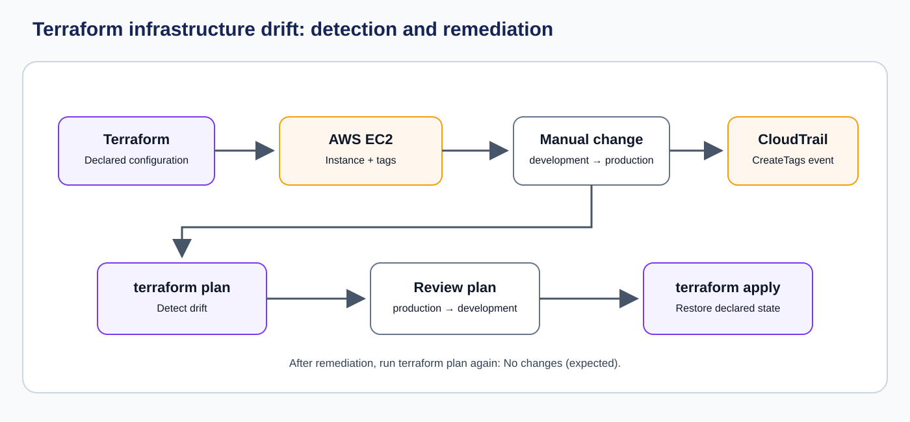

# Terraform Infrastructure Drift Detection and Remediation on AWS

A practical AWS demonstration of infrastructure drift detection, investigation, and remediation using Terraform, Amazon EC2, AWS CLI, and AWS CloudTrail.

## Overview

Infrastructure drift occurs when the actual configuration of an AWS resource differs from the desired configuration defined in Infrastructure as Code.

In this project, Terraform provisions an Amazon EC2 instance. A manual modification changes the instance's `Environment` tag outside Terraform. Terraform detects the difference, AWS CloudTrail provides an audit record of the modification, and Terraform restores the declared configuration.

## Architecture



## Technologies Used

| Technology                | Purpose                                                      |
| ------------------------- | ------------------------------------------------------------ |
| Terraform                 | Infrastructure provisioning, drift detection and remediation |
| Amazon EC2                | Resource used for the drift demonstration                    |
| Amazon VPC Security Group | Network access control                                       |
| AWS CloudTrail            | Audit trail for manual AWS API changes                       |
| AWS CLI                   | Resource inspection and validation                           |
| PowerShell                | Local command execution                                      |

## Project Structure

```text
article-03-terraform-infrastructure-drift/
│
├── README.md
├── ARTICLE.md
│
├── images/
│   └── terraform-drift-architecture.svg
│
├── terraform/
│   ├── versions.tf
│   ├── provider.tf
│   ├── main.tf
│   ├── variables.tf
│   ├── outputs.tf
│   └── .gitignore
│
└── evidence/
    ├── screenshots/
    ├── ec2-initial-tags-sanitized.json
    ├── ec2-drifted-tags-sanitized.json
    ├── ec2-remediated-tags-sanitized.json
    ├── terraform-plan-baseline-summary.json
    ├── terraform-plan-drift-summary.json
    ├── terraform-plan-remediated-summary.json
    └── cloudtrail-manual-change-sanitized.json
```

## AWS Region

```text
ap-south-2
```

## Implementation Workflow

### 1. Initialize Terraform

Navigate to the Terraform directory:

```powershell
cd terraform
```

Initialize the working directory:

```powershell
terraform init
```

Format and validate:

```powershell
terraform fmt -recursive
terraform validate
```

### 2. Review and deploy infrastructure

Generate the execution plan:

```powershell
terraform plan -out=tfplan
```

Apply the reviewed plan:

```powershell
terraform apply tfplan
```

### 3. Verify the original EC2 configuration

Retrieve the instance ID:

```powershell
$instanceId = terraform output -raw instance_id
```

Inspect the tags:

```powershell
aws ec2 describe-tags `
  --filters "Name=resource-id,Values=$instanceId" `
  --region ap-south-2 `
  --output table
```

The original Environment tag is:

```text
development
```

### 4. Introduce infrastructure drift

Manually change the EC2 instance's Environment tag through the AWS Console:

```text
development → production
```

### 5. Detect drift

Execute:

```powershell
terraform plan
```

Terraform should identify the proposed tag correction:

```text
production → development
```

Save the plan:

```powershell
terraform plan -out=drift-plan
```

### 6. Investigate using CloudTrail

Query the EC2 tag modification event:

```powershell
aws cloudtrail lookup-events `
  --lookup-attributes AttributeKey=EventName,AttributeValue=CreateTags `
  --max-results 50 `
  --region ap-south-2 `
  --output json
```

Inspect the event associated with the EC2 instance.

### 7. Remediate infrastructure drift

Apply the reviewed plan:

```powershell
terraform apply drift-plan
```

Verify the corrected tag through AWS CLI.

### 8. Final validation

Run:

```powershell
terraform plan
```

Expected result:

```text
No changes. Your infrastructure matches the configuration.
```

## Validation Scenarios

| Scenario                     | Expected result             |
| ---------------------------- | --------------------------- |
| Initial Terraform deployment | Resources created           |
| Initial Terraform plan       | No changes                  |
| Manual EC2 tag modification  | Drift introduced            |
| Terraform drift detection    | Tag difference identified   |
| CloudTrail investigation     | CreateTags event identified |
| Terraform remediation        | Original tag restored       |
| Final Terraform plan         | No changes                  |

## Evidence

The `evidence/` directory contains sanitized implementation evidence and selected screenshots documenting:

* Initial EC2 configuration.
* Manual infrastructure modification.
* Terraform drift detection.
* CloudTrail investigation.
* Terraform remediation.
* Final no-drift validation.

## Cleanup

After completing the demonstration and collecting evidence:

```powershell
terraform destroy
```

Review the resources Terraform proposes to delete before confirming.

The temporary EC2 instance and security group should be removed.

## Security Considerations

* Do not commit Terraform state files.
* Do not commit AWS credentials or temporary session credentials.
* Inspect CloudTrail JSON before publishing it.
* Remove unnecessary AWS account identifiers and IP addresses from public evidence.
* Do not publish raw Terraform state or unreviewed plan files.
* Review Terraform plans before applying changes.

## Key Learnings

* Understanding infrastructure drift.
* Terraform state and refresh behavior.
* Detecting configuration differences using Terraform plan.
* Investigating AWS API activity using CloudTrail.
* Reviewing and applying controlled infrastructure corrections.
* Maintaining consistency between desired and actual infrastructure.

## Article

The complete technical walkthrough is documented in [ARTICLE.md](ARTICLE.md).
