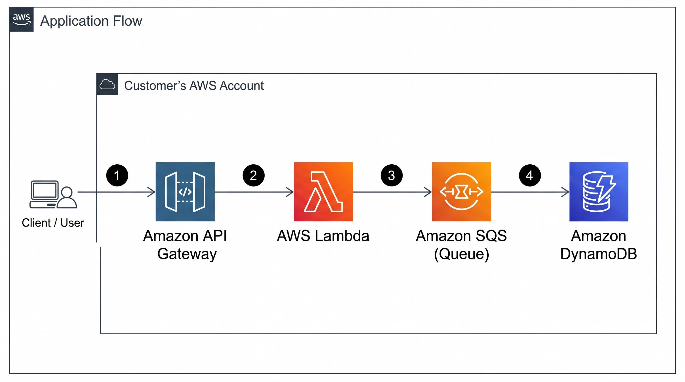

# Article 07 — Detecting AWS Security Group Changes with CloudTrail, EventBridge, and SNS

This project demonstrates an event-driven notification workflow for selected Amazon EC2 security group rule changes. CloudTrail management events are matched by EventBridge and routed to an SNS topic for email notification.

> **Cost notice:** This project creates AWS resources and is not guaranteed to be free. Review current AWS pricing and your account billing before deployment.

## Implementation status

- Terraform configuration and event-driven notification resources are provided.
- Deployment, verification, controlled test, and cleanup scripts are included.

## Architecture



```text
EC2 security group API call -> CloudTrail -> EventBridge -> SNS -> Confirmed email
```

## Project structure

```text
article-07-cloudtrail-event-monitoring/
├── ARTICLE.md
├── README.md
├── .gitignore
├── images/architecture.svg
├── terraform/
│   ├── versions.tf
│   ├── providers.tf
│   ├── variables.tf
│   ├── main.tf
│   ├── outputs.tf
│   └── terraform.tfvars.example
├── scripts/
│   ├── deploy.sh
│   ├── subscribe-email.sh
│   ├── verify.sh
│   ├── test-alert.sh
│   └── destroy.sh
└── evidence/
    ├── README.md
    ├── results/.gitkeep
    └── screenshots/.gitkeep
```

## Prerequisites

- Linux shell.
- Terraform CLI version 1.6 or later.
- AWS CLI v2 configured with an identity authorized to manage these resources.
- An email address you can access to confirm the SNS subscription.

Note - Never commit AWS credentials, local `terraform.tfvars`, Terraform state, plan files, or sensitive evidence.

## Configure and deploy

```bash
cp terraform/terraform.tfvars.example terraform/terraform.tfvars
terraform -chdir=terraform fmt -recursive
terraform -chdir=terraform init
terraform -chdir=terraform validate
terraform -chdir=terraform plan
./scripts/deploy.sh
```
### Terraform Apply


## Subscribe to notifications

```bash
./scripts/subscribe-email.sh YOUR_EMAIL_ADDRESS
```

Confirm the subscription using the message sent by Amazon SNS. The endpoint must be confirmed before it can receive notifications.


## Verify and test

```bash
./scripts/verify.sh
./scripts/test-alert.sh
```

The test script temporarily authorizes TCP port 22 from `203.0.113.0/24` on the dedicated test security group, then removes the rule. This is a documentation-only CIDR range used to generate a controlled API event. Do not use a production security group or replace it with `0.0.0.0/0`.


## Cleanup

```bash
./scripts/destroy.sh
```

Review the Terraform destroy plan and confirm that only this demonstration's resources will be removed.


## Limitations

This is a focused demonstration for selected EC2 security group API events, not a complete AWS security monitoring solution. Event delivery is asynchronous. Production deployments should add appropriate monitoring, failure handling, least-privilege access, and incident response procedures.
